# ApexMarketEngine — Full System Architecture Specification & Mermaid Blueprint

```mermaid
flowchart TD
    %% =========================================================================
    %% LAYER 1: DATA INGESTION & CHRONO-VAULT OLAP LAKEHOUSE
    %% =========================================================================
    subgraph L1 ["Layer 1: Data Ingestion & CHRONO-VAULT OLAP Lakehouse"]
        direction TB
        L1_Raw["Raw Data Sources<br/>• 12-Yr Floor-Sheet Ticks (2014–2026)<br/>• 719k+ Daily OHLCV Bars<br/>• Broker Floor Sheets & Order Logs<br/>• Corporate Disclosures & NRB Circulars<br/>• Promoter Lock-In Expiry Calendar"]
        
        L1_Engine["CHRONO-VAULT Vectorized Engine (DuckDB + Parquet)<br/>• Sub-92ms Query Latency over 644k+ Ticks<br/>• Hive-Partitioned Zero-Copy Parquet Store<br/>• Point-in-Time (PIT) Split-Adjustment Engine<br/>• Anti-Wash Trade Filter (Buyer Broker == Seller Broker)"]
        
        L1_FracDiff["Fractional Differentiation Engine (d = 0.35)<br/>• Memory-Preserving Stationarity (ADF Test p = 0.0121 < 0.05)<br/>• Preserves >0.90 Price Correlation<br/>• Fixed-Width Window Backshift Expansion"]
        
        L1_Raw --> L1_Engine --> L1_FracDiff
    end

    %% =========================================================================
    %% LAYER 2: MICROSTRUCTURE, SYNDICATES & MACRO CALENDAR
    %% =========================================================================
    subgraph L2 ["Layer 2: Microstructure, Broker Syndicates & Macro Drivers"]
        direction TB
        L2_OFI["Cont-Stoikov Order Flow Imbalance (OFI)<br/>• Broker-Level Bid/Ask Net Buying Pressures"]
        L2_VPIN["Volume-Synchronized Toxicity (VPIN)<br/>• Informed Trading & Adverse Selection Risk"]
        L2_Hawkes["Hawkes Point Process Syndicate Tracker<br/>• Accumulation/Dumping Sweeps (Brokers 58, 45, 49)"]
        L2_Macro["NEPSE Macro & Calendar Engine<br/>• Bikram Sambat Fiscal Year-End Liquidity<br/>• Monsoon Hydro RoR STL Seasonal Cycles<br/>• NRB Interest Rate & Reserve Directives"]
        
        L2_OFI --- L2_VPIN --- L2_Hawkes --- L2_Macro
    end

    %% =========================================================================
    %% LAYER 3: HYBRID PROBABILISTIC FORECASTING ENGINE
    %% =========================================================================
    subgraph L3 ["Layer 3: Probabilistic Forecasting & Temporal Ensembling"]
        direction TB
        L3_Chronos["Amazon Chronos-Bolt (48M)<br/>• 5-Session P10 / P50 / P90 Probabilistic Corridors"]
        L3_LGBM["LightGBM Cross-Sectional Ranker<br/>• Combinatorial Purged & Embargoed Cross-Validation (CPCV)"]
        L3_Kronos["AAAI 2026 Kronos 5D Tokenizer<br/>• Continuous Candlestick Tokenization [O, H, L, C, V]"]
        L3_MeanRev["Calibrated Mean Reversion Engine<br/>• Regime-Adaptive Signal Routing (System 1 vs System 2)"]
        
        L3_Chronos --- L3_LGBM --- L3_Kronos --- L3_MeanRev
    end

    %% =========================================================================
    %% LAYER 4: FORENSIC GOVERNANCE & SETTLEMENT SHIELDS
    %% =========================================================================
    subgraph L4 ["Layer 4: Forensic Governance & Triple-Barrier Labeling"]
        direction TB
        L4_TB["López de Prado Triple-Barrier Method<br/>• Dynamic 2.0σ Upper Profit / Lower Stop / Time Limits"]
        L4_Meta["Gate G4 Meta-Labeler<br/>• False Positive Precision Filtering + Laplace Smoothing"]
        L4_CDSC["CDSC T+2 Demat Settlement Shield<br/>• Capital Lock-Up & Illiquidity Guard"]
        L4_Amihud["Amihud Liquidity & Circuit Breaker Filter<br/>• Pre-Trade Halted Security Rejection"]
        
        L4_TB --> L4_Meta --> L4_CDSC --> L4_Amihud
    end

    %% =========================================================================
    %% LAYER 5: PORTFOLIO RISK & HYSTERESIS REBALANCING
    %% =========================================================================
    subgraph L5 ["Layer 5: Portfolio Risk & Hysteresis Rebalancing Engine"]
        direction TB
        L5_HRP["Hierarchical Risk Parity (HRP)<br/>• Tree Clustering Portfolio Allocation"]
        L5_Hysteresis["Hysteresis Retention Algorithm<br/>• Buy Top 5, Hold in Top 15 Candidates<br/>• Slashes Friction Turnover from 100% to 11.9%<br/>• Delivers +3,438.94% Net Return (Post 0.65% Fee Drag)"]
        L5_Cash["Dynamic Cash Buffer Engine<br/>• Up to 25% Defensive Cash Allocation in High-Vol Regimes"]
        L5_NRB["NRB Regulatory Exposure Rules<br/>• 120% Margin Coverage & Single Issuer Banking Sector Caps"]
        
        L5_HRP --> L5_Hysteresis --> L5_Cash --> L5_NRB
    end

    %% =========================================================================
    %% LAYER 6: ALGORITHMIC EXECUTION CONTROL PLANE
    %% =========================================================================
    subgraph L6 ["Layer 6: Microstructure Execution Control Plane"]
        direction TB
        L6_TWAP["Empirical U-Shaped Intraday VWAP/TWAP Slicer<br/>• 11:00 AM – 3:00 PM Execution Window"]
        L6_Almgren["Almgren-Chriss Optimal Execution<br/>• Depth Participation Cap <= 15% of Top-3 LOB"]
        L6_PreOpen["Pre-Open Session Audit (10:30 – 10:45 AM)<br/>• Rejects Spoofing & Order Cancellations > 35%"]
        
        L6_TWAP --- L6_Almgren --- L6_PreOpen
    end

    %% =========================================================================
    %% LAYER 7: CLEF MULTIMODAL VLM & REMOTE COLAB GPU BRIDGE
    %% =========================================================================
    subgraph L7 ["Layer 7: CLEF Multimodal VLM & Remote Colab T4 Bridge"]
        direction TB
        subgraph L7_Local ["Local Bridge Worker (scripts/33_clef_inference_bridge.py)"]
            direction TB
            L7_Base64["Headless Matplotlib Agg PNG<br/>• In-Memory Base64 Render (Zero Local File Leakage)"]
            L7_Hash["Master SHA-256 Provenance Seal<br/>• Composite Hash: H_master = SHA256(Ctx:Fcst:Disc:Vis)"]
            L7_Base64 --> L7_Hash
        end
        
        subgraph L7_Tunnel ["Cloudflare Encrypted Tunnel"]
            direction TB
            L7_E2E["HTTPS POST /synthesize<br/>• Measured Latency: 8.42s RTT | 130KB Payload"]
        end

        subgraph L7_Remote ["Remote Colab / GCP GPU Compute"]
            direction TB
            L7_GPU["NVIDIA Tesla T4 GPU (16GB VRAM, FP16 Async FastAPI)"]
            L7_VLM["Qwen2.5-VL-3B Multimodal Vision-Language Transformer"]
            L7_LoRA["PEFT/LoRA Adapter (r=16, alpha=32, 65MB Safetensors)"]
            L7_GPU --> L7_VLM
            L7_LoRA -.-> L7_VLM
        end

        subgraph L7_CB ["Cryptographic Fail-Closed Circuit Breaker"]
            direction TB
            L7_Valid{"Pydantic v2 Valid & Hash Match?"}
            L7_Pass["PASS: Persist static_data/clef_analyst_report.json"]
            L7_Fail["FAIL-CLOSED: Revert to Deterministic Quant-Only Mode"]
            L7_Valid -->|"Yes"| L7_Pass
            L7_Valid -->|"No / Timeout >45s"| L7_Fail
        end

        L7_Hash --> L7_E2E --> L7_GPU
        L7_VLM --> L7_E2E --> L7_Valid
    end

    %% =========================================================================
    %% LAYER 8: 10-GATE FORENSIC AUDIT & CERTIFICATION MATRIX
    %% =========================================================================
    subgraph L8 ["Layer 8: 10-Gate Forensic Certification Matrix"]
        direction TB
        L8_Gates["Gate Certification Matrix<br/>• G1: Purged Walk-Forward (10d Purge, 5d Embargo)<br/>• G2: FracDiff Stationarity (ADF p < 0.05)<br/>• G3: Friction Drag Audit (0.65% Fee Net Positive)<br/>• G4: Deflated Sharpe Ratio (DSR >= 0.95)<br/>• G5: Max Drawdown Guard (MDD <= 18.5% 90d)<br/>• G6: Rank Information Coefficient (IC >= +0.04)<br/>• G7: TreeSHAP Unlagged Feature Dominance Audit<br/>• G8: Pydantic v2 Canonical Schema Enforcement<br/>• G9: Zero Host Path Leakage (In-Memory Base64)<br/>• G10: Master SHA-256 Provenance Verification"]
    end

    %% =========================================================================
    %% LAYER 9: PROGRESSIVE DISCLOSURE UX & TERMINAL INTERFACES
    %% =========================================================================
    subgraph L9 ["Layer 9: Progressive Disclosure UX & Terminals"]
        direction TB
        subgraph L9_Tiers ["3-Tier Progressive UX"]
            direction TB
            L9_T1["Tier 1: Executive Panel<br/>• High-Conviction Layman Summary, Rank #1 Target & Stop-Loss"]
            L9_T2["Tier 2: Evidence Matrix<br/>• Multimodal Market Context, 2.0σ Price Corridor & Broker OFI"]
            L9_T3["Tier 3: Quant Analytical Row<br/>• Forensic FracDiff Statistics, SHAP Importances & Backtest Proof"]
            L9_T1 --> L9_T2 --> L9_T3
        end

        subgraph L9_Terminals ["Delivery Terminals & Execution APIs"]
            direction TB
            L9_Streamlit["Streamlit Terminal UI (:8501)<br/>(scripts/08_dashboard_ui/04_streamlit_terminal_ui.py)"]
            L9_Prism["PRISM Station<br/>(launch_prism_station.py)"]
            L9_Hedge["Hedge Terminal<br/>(hedge_terminal.py)"]
            L9_TMS["NEPSE Broker TMS Order Staging REST API"]
        end

        L9_Tiers --> L9_Terminals
    end

    %% =========================================================================
    %% MAIN PIPELINE CONNECTIONS
    %% =========================================================================
    L1_FracDiff -->|"Cleaned PIT Bars & FFD Features"| L2
    L2 -->|"Microstructure Signals & Macro Regimes"| L3
    L3 -->|"Probabilistic Forecasts & Quantiles"| L4
    L4 -->|"Triple-Barrier Meta-Labeled Signals"| L5
    L5 -->|"Target Portfolio Weights & Allocations"| L6
    L5 -->|"Forecast Context & Base64 Chart Render"| L7_Local
    L7_Pass --> L8
    L7_Fail --> L8
    L8 -->|"Certified Production Signals"| L9
```

---

## 📌 Layer Summary Matrix

| Layer # | System Submodule | Primary Technologies & Specifications | Key Outputs / SLAs |
| :---: | :--- | :--- | :--- |
| **Layer 1** | **Data Ingestion & CHRONO-VAULT OLAP** | DuckDB, Apache Parquet, Fractional Differentiation ($d=0.35$) | Sub-92ms query latency over 644k+ ticks; Stationary price series ($p=0.0121$) |
| **Layer 2** | **Microstructure & Macro Drivers** | Cont-Stoikov OFI, VPIN Toxicity, Hawkes Point Process | Broker syndicate tracking (Brokers 58, 45, 49) & Fiscal Year-End seasonal filters |
| **Layer 3** | **Hybrid Probabilistic Forecasting** | Amazon Chronos-Bolt (48M), LightGBM Ranker, AAAI 2026 Kronos 5D | Quantile uncertainty corridors (P10/P50/P90), CPCV 10-fold cross-validation |
| **Layer 4** | **Forensic Governance & Shields** | López de Prado Triple-Barrier, Meta-Labeler (Gate G4), CDSC Shield | $2.0\sigma$ Volatility corridors, T+2 Demat capital lock-up protection |
| **Layer 5** | **Portfolio Risk & Hysteresis** | Hierarchical Risk Parity (HRP), Hysteresis Retention Algorithm | Cut turnover from 100% to 11.9%; **+3,438.94% net cumulative return** |
| **Layer 6** | **Microstructure Execution Control** | Almgren-Chriss Slicing, U-Shaped VWAP, Pre-Open Audit | Top-3 LOB depth participation cap $\le 15\%$; Spoofing rejection (>35% cancellations) |
| **Layer 7** | **CLEF Multimodal VLM & Colab Bridge** | Qwen2.5-VL-3B LoRA ($r=16, \alpha=32$), Cloudflare Tunnel, FastAPI FP16 | 8.42s RTT multimodal analysis, zero local file leakage, fail-closed breaker |
| **Layer 8** | **10-Gate Forensic Certification** | 10-Gate Audit Suite (`tests/regression_suite.py`) | Deflated Sharpe $\ge 0.95$, Rank IC $\ge +0.04$, Master SHA-256 provenance hash |
| **Layer 9** | **Progressive UX & Execution** | Streamlit UI, PRISM Station, Hedge Terminal, Broker TMS REST API | 3-Tier progressive disclosure UX, automated pre-open order staging |
