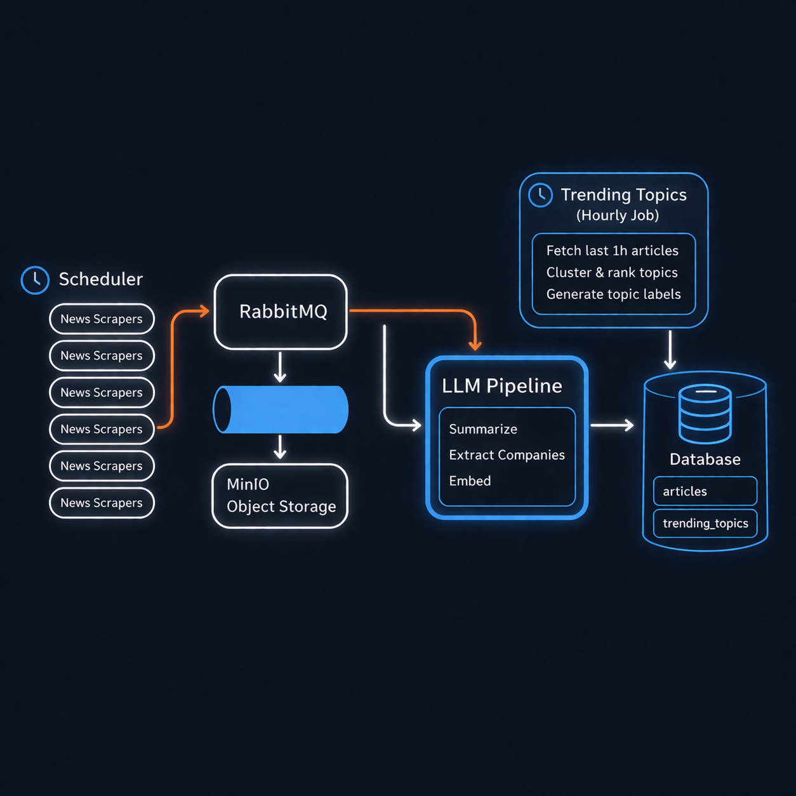

# Nepali News Intelligence Pipeline

A production scraping and enrichment system for Nepali financial news. Scrapes 14 sources hourly, enriches articles with LLM-generated summaries, embeddings, and NEPSE company/sector extraction, then serves insights through a PostgreSQL vector store.

## Architecture

```
Scheduler (hourly)
│
▼
RabbitMQ (scraper_tasks queue)
│
▼
Scraper Workers ──► 14 sources (news portals, NEPSE, Instagram, ICRA, NRB)
│
▼
ScraperService.save_json()
│
▼
MinIO / S3-compatible object storage
│
▼
LLM Pipeline (pluggable provider)
├── Summary + impact/relevance scoring
├── NEPSE sector and company extraction
└── 768-dim embedding generation
│
▼
PostgreSQL (pgvector)
├── embeddings
├── events
├── article_summaries
├── news_impact (sector + company linkage)
├── trending_topics
└── nepse_companies / nepse_sectors
```

## Supported Sources

| Key | Source |
|---|---|
| `gorkhapatra` | Gorkhapatra Online |
| `sharesansar` | ShareSansar |
| `kathmandupost` | The Kathmandu Post |
| `setopati` | Setopati |
| `republica` | My Republica |
| `annapurna` | The Annapurna Post |
| `nepalipaisa` | Nepali Paisa |
| `merolagani` | Mero Lagani |
| `nepalitimes` | Nepali Times |
| `kantipur` | Ekantipur |
| `instagram` | Instagram (RONB) |
| `icra` | ICRA Nepal (PDF reports) |
| `nrb` | Nepal Rastra Bank (PDF reports) |
| `nepse` | NEPSE company/sector registry |

## LLM Provider Abstraction

The pipeline is not tied to any single LLM. Switch providers by setting `LLM_PROVIDER` in your `.env`.

```bash
LLM_PROVIDER=gemini   # default
LLM_PROVIDER=openai
LLM_PROVIDER=groq     # recommended for high RPM free tier
```

To add a new provider, implement `LLMProvider` in `services/llm/base.py` and register it in `services/llm/factory.py`.

## Data Flow Per Article

1. Scraper collects article and normalizes it to a common schema  
2. JSON payload uploaded to MinIO  
3. LLM extracts summary, impact score (0–1), relevance score (0–1)  
4. LLM identifies affected NEPSE sectors and mentioned companies  
5. 768-dim embedding generated and stored in pgvector  
6. Trending topics generated from high-signal articles every hour  

## Setup

**Prerequisites:** Python 3.11+, Poetry, PostgreSQL with `pgvector`, RabbitMQ, MinIO/S3-compatible bucket

```bash
cp .env.example .env
# fill in DB, MinIO, RabbitMQ, and LLM credentials
poetry install
```

## Running

```bash
# Daemon mode — scheduler + RabbitMQ listener
poetry run python -m nepali_news_scrapers.main

# Single scraper
poetry run python -m nepali_news_scrapers.cli scrape gorkhapatra

# Generate trending topics manually
poetry run python -m nepali_news_scrapers.cli trending
```

## Tests

```bash
poetry run pytest
```

Fixtures and HTML snapshots live in:

```
nepali_news_scrapers/tests/html_test_files/
```

## Environment Variables

| Variable | Purpose |
|---|---|
| `DB_HOST` `DB_PORT` `DB_NAME` `DB_USER` `DB_PASSWORD` | PostgreSQL connection |
| `AWS_S3_ENDPOINT` `AWS_ACCESS_KEY_ID` `AWS_SECRET_ACCESS_KEY` `AWS_BUCKET_NAME` | Object storage |
| `RABBITMQ_HOST` `RABBITMQ_PORT` `RABBITMQ_USER` `RABBITMQ_PASSWORD` | Queue |
| `LLM_PROVIDER` | `gemini`, `openai`, or `groq` |
| `GEMINI_API_KEY` | Gemini key (up to 3 supported via `GEMINI_API_KEY_2`, `GEMINI_API_KEY_3`) |
| `GEMINI_EMBED_MODEL` `GEMINI_GENERATE_MODEL` | Model names |

See `.env.example` for the full list.

## Operational Notes

- Scheduler skips runs between 11 PM and 8 AM Kathmandu time  
- NEPSE scraper has a 7-day cooldown to avoid redundant registry fetches  
- Trending generation runs ~1 hour after scraper trigger with two automatic retries  
- Gemini key rotation is automatic on rate limit  
